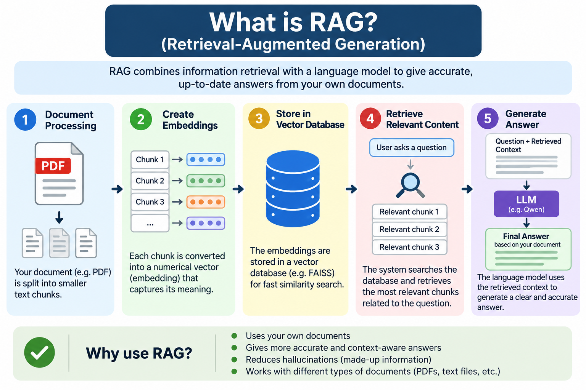

# Document Intelligence RAG System

A Retrieval-Augmented Generation (RAG) application that allows users to upload PDF documents and ask questions about their contents using natural language.

The system retrieves relevant document passages and uses them as context to generate answers grounded in the uploaded document.

## Project Overview

Reading lengthy documents manually can be time-consuming. This project demonstrates how RAG can make document search and question answering more efficient.

Users can process a PDF, retrieve relevant text chunks, and ask questions such as:
- What are the main projects mentioned?
- What are the important dates and milestones?
- Which model was selected, and what were its evaluation metrics?
- What information is available about a specific topic?

The system is designed to answer from document evidence rather than rely solely on general model knowledge.

## Key Features

- **PDF question answering:** Ask natural-language questions about document contents.
- **Document processing:** Extract text and split it into manageable chunks.
- **Semantic search:** Retrieve passages based on meaning.
- **Hybrid retrieval:** Combine semantic similarity and keyword-based retrieval.
- **Context-aware generation:** Generate answers using retrieved document excerpts.
- **Evidence-based responses:** Instruct the model not to invent information missing from the document.
- **Reusable workflow:** Process different PDFs by loading the new document and rebuilding the retrieval index.

## Architecture



### How It Works

1. **Upload a document:** Provide a PDF file.
2. **Extract text:** Read the document and extract its text.
3. **Chunk the text:** Divide the extracted text into smaller passages.
4. **Generate embeddings:** Convert passages into numerical representations.
5. **Retrieve relevant passages:** Use semantic and keyword-based similarity to find relevant context.
6. **Generate an answer:** Pass the retrieved context and the user's question to the language model.
7. **Display the result:** Return an answer grounded in the available document evidence.

## Technology Stack

- Python
- Google Colab
- Sentence Transformers
- FAISS
- TF-IDF and cosine similarity
- Qwen language model
- PyTorch
- PDF text extraction tools

## Getting Started

### Option 1: Run in Google Colab

1. Open `Document_Intelligence_RAG.ipynb` from this repository.
2. Open the notebook in Google Colab.
3. Select a runtime and enable a GPU if the notebook's model requires or benefits from one.
4. Run the setup and import cells.
5. Upload a PDF document when prompted.
6. Execute the document-processing and retrieval cells.
7. Ask questions about the uploaded document using the question-answering function.

### Option 2: Install Dependencies Locally

Clone the repository:

```bash
git clone https://github.com/Ashraf310120/document-intelligence-rag-system.git
cd document-intelligence-rag-system
```

Create and activate a virtual environment, then install the dependencies:

```bash
python -m venv .venv
```

On Windows:

```bash
.venv\Scripts\activate
```

Install the required packages:

```bash
pip install -r requirements.txt
```

Open the notebook in Jupyter or Google Colab and follow its execution instructions.

**Note:** Local execution may require additional model downloads, sufficient RAM or GPU memory, and configuration specific to the notebook.

## Example Questions

```python
ask_pdf("What are the project names and how many projects are mentioned?")

ask_pdf("List all project milestone dates and planned future dates.")

ask_pdf("Which model was selected, and what were its ROC AUC and precision?")

ask_pdf("What is the approved churn-risk threshold and prediction window?")
```

These are example questions from the sample-document workflow. The answers depend on the PDF being processed.

## Important Considerations

- Answer quality depends on the PDF's text quality, retrieval settings, and language model.
- Scanned PDFs may require OCR before text extraction.
- Broad questions may need more retrieved context than specific questions.
- Missing or ambiguous information should be reported rather than fabricated.
- Large documents and language models may require significant memory and processing time.
- Never commit API keys, passwords, personal resumes, or confidential documents to a public repository.

## Future Improvements

- Add a simple Streamlit or Gradio user interface.
- Support multiple file formats, such as DOCX and TXT.
- Add source citations and page references to generated answers.
- Improve retrieval using reranking and metadata filtering.
- Add automated evaluation for retrieval quality and answer accuracy.
- Add automated tests and error handling.

## Author

**Ashraf Hussain**

GitHub: [@Ashraf310120](https://github.com/Ashraf310120)

## License

No license has been added to this repository yet. Reuse and redistribution permissions should be specified before others reuse the project.
